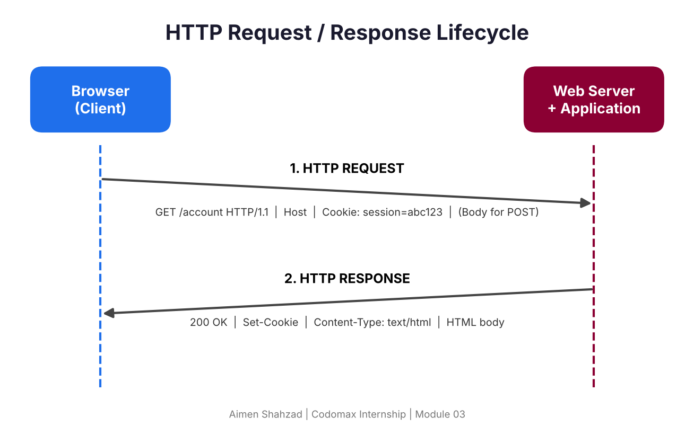
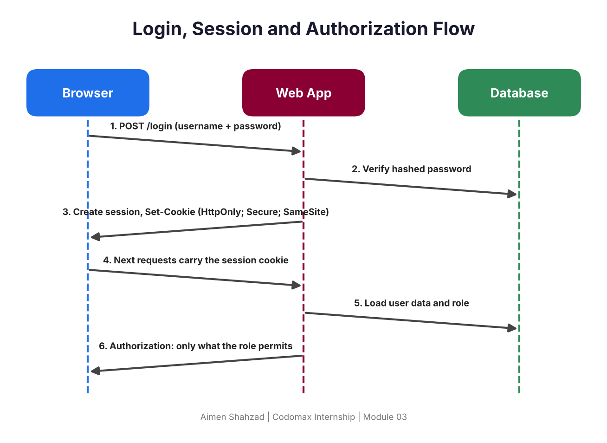

# 1. Web Application Fundamentals

## 1.1 How a web application works
A web application has three parts: the **browser (client)**, the **web server / application** and the **database**. The browser sends requests, the server processes them using application logic and the database, and sends back a response.

## 1.2 HTTP request and response
**Request:** method (GET, POST, PUT, DELETE), URL, headers (Host, Cookie, User-Agent), optional body.
**Response:** status code, headers (Set-Cookie, Content-Type), body (HTML, JSON).

| Status | Meaning |
|---|---|
| 200 OK | Request succeeded |
| 301 / 302 | Redirect |
| 400 Bad Request | Invalid request |
| 401 Unauthorized | Authentication required or failed |
| 403 Forbidden | Authenticated but not allowed |
| 404 Not Found | Resource does not exist |
| 500 Internal Server Error | Server problem |

HTTP is **stateless**: the server does not remember earlier requests, so cookies and sessions are used to keep a user logged in.

## 1.3 Cookies and sessions
- A **cookie** is a small piece of data stored in the browser and sent with every request to that site.
- A **session** is the server-side record of a logged-in user, identified by a **session ID** stored in a cookie.
- Secure cookie flags: `HttpOnly` (JavaScript cannot read it), `Secure` (sent only over HTTPS), `SameSite` (limits cross-site sending, helps against CSRF).

## 1.4 Authentication and authorization
- **Authentication:** proving who you are (password, MFA).
- **Authorization:** deciding what you can access (roles and permissions).
- Authorization must always be checked **on the server** for every request.

