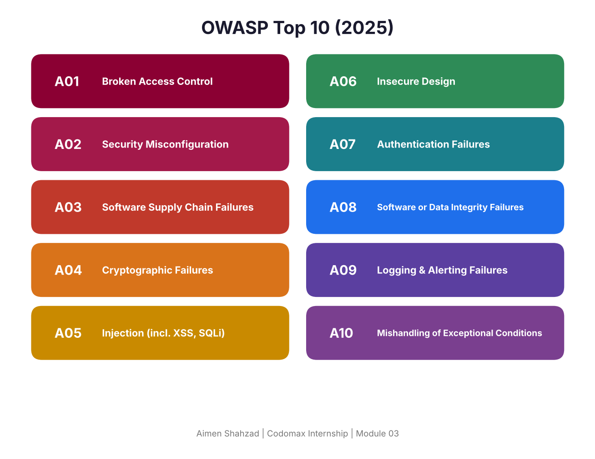

# 2. OWASP Top 10 (2025) Analysis

The OWASP Top 10 is an awareness document listing the most critical web application security risks. The 2025 edition adds *Software Supply Chain Failures* (A03) and *Mishandling of Exceptional Conditions* (A10). Cross-Site Scripting (XSS) and SQL injection belong to **A05 Injection**. Authentication Failures (A07) was called "Identification and Authentication Failures" in 2021.

| ID | Risk | What it is | Example | Prevention |
|---|---|---|---|---|
| A01 | Broken Access Control | Users can act outside their permissions | Changing `?id=5` to `?id=6` to see another user's data | Deny by default, check ownership on the server, least privilege |
| A02 | Security Misconfiguration | Insecure default or incomplete settings | Default admin password, verbose errors, open cloud storage | Hardening, remove defaults, security headers, review configs |
| A03 | Software Supply Chain Failures | Vulnerable or malicious third-party components and build pipeline | Outdated library with known CVE | Keep inventory (SBOM), update, verify sources, scan dependencies |
| A04 | Cryptographic Failures | Weak or missing protection of sensitive data | Passwords in plain text, HTTP instead of HTTPS | TLS everywhere, strong hashing (bcrypt/Argon2), manage keys safely |
| A05 | Injection | Untrusted input is run as a command or code (SQLi, XSS, command injection) | `' OR '1'='1` in a login form; script in a comment field | Parameterized queries, input validation, output encoding, CSP |
| A06 | Insecure Design | Missing security in the design itself | No limit on password reset attempts | Threat modeling, secure design patterns, abuse-case tests |
| A07 | Authentication Failures | Weak login, session or credential handling | Weak passwords allowed, no MFA, session ID in URL | MFA, strong password policy, rate limiting, secure sessions |
| A08 | Software or Data Integrity Failures | Code or data trusted without verification | Unsigned updates, insecure deserialization | Signatures, integrity checks, trusted pipelines |
| A09 | Logging & Alerting Failures | Attacks go unnoticed | No logs of failed logins | Log security events, alerting, protect and monitor logs |
| A10 | Mishandling of Exceptional Conditions | Errors and failures handled badly | Stack trace shown to users; system fails open | Handle errors safely, generic messages, fail closed |

## Injection types in the module
- **SQL injection:** attacker input changes a database query.
- **Cross-Site Scripting (XSS):** attacker script runs in another user's browser (reflected, stored, DOM-based).
- **Command injection:** input reaches an operating system command.

## Why Broken Access Control stays #1
It is common, easy to introduce and often invisible to scanners because only the application knows who should see what.
