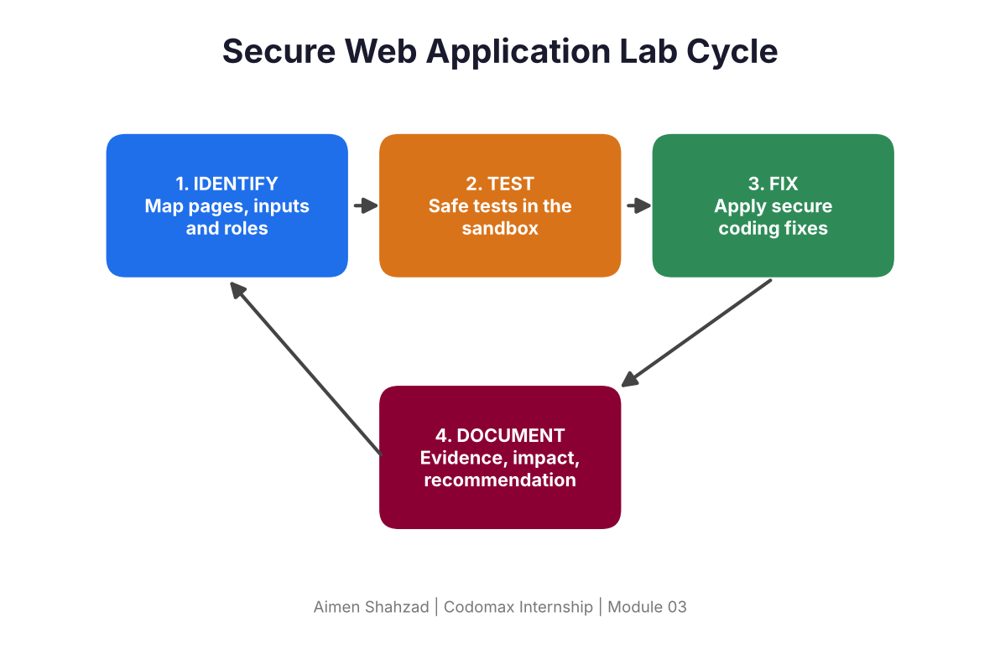

# 4. Secure Web Application Lab

The lab follows **Identify → Test → Fix → Document** inside a safe sandbox.

## Rules
1. Use only a sandbox: OWASP Juice Shop, DVWA or my own local test application.
2. Never test a real website without written permission.
3. Use harmless test inputs and do not damage or overload the application.
4. Record every step with evidence (screenshots, requests, responses).

## Phases
| Phase | Activity |
|---|---|
| Identify | Map pages, forms, inputs, user roles, cookies and technologies |
| Test | Try safe tests for injection, XSS, access control and authentication weaknesses |
| Fix | Apply secure coding fixes and re-test |
| Document | Write the vulnerability report and remediation recommendations |
