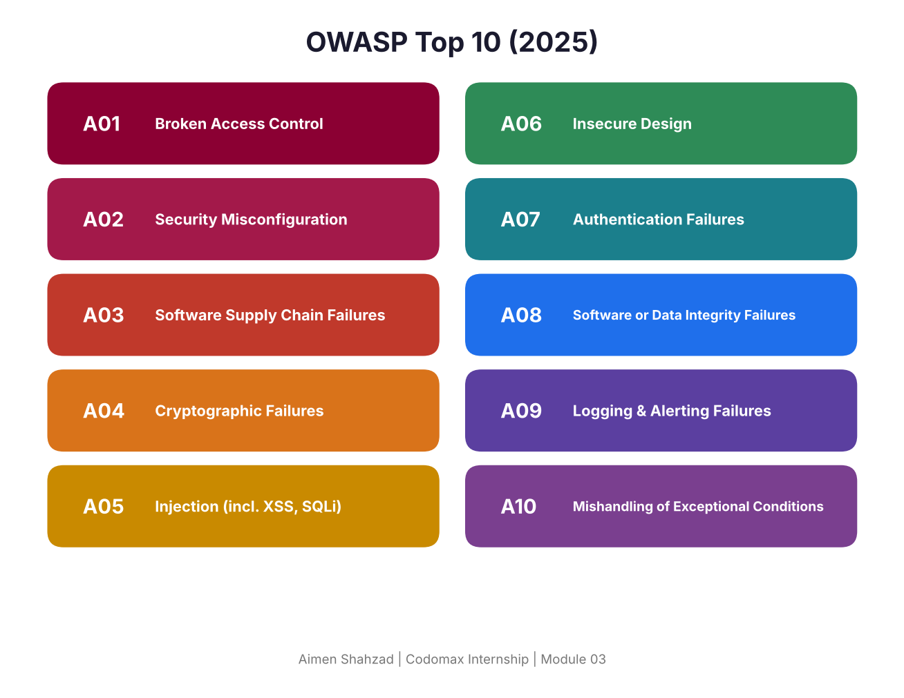

# Module 03: Web Application Security

**Intern:** Aimen Shahzad
**Program:** BS Information Technology, Emerson University Multan
**Internship:** Codomax Digital Solutions (Online Cybersecurity Internship)
**Module:** 03 | 23/11/2026 - 27/11/2026

This repository contains my learning notes, OWASP Top 10 analysis, vulnerability report, remediation recommendations, secure lab guide and demo walkthrough for Module 03.

> **Ethics notice:** All testing is done only in a safe sandbox (for example OWASP Juice Shop, DVWA or my own local test application). I never test a website without permission.

## Repository files

| File | Contents |
|---|---|
| `01-web-fundamentals.md` | HTTP request/response lifecycle, cookies, sessions, authentication and authorization |
| `02-owasp-top-10-analysis.md` | OWASP Top 10 (2025): description, example, impact and prevention |
| `03-secure-coding-practices.md` | Secure coding principles and examples |
| `04-secure-web-app-lab.md` | Identify, Test, Fix, Document lab design and rules |
| `lab-guide.md` | Step-by-step lab tasks |
| `vulnerability-report.md` | Vulnerability report template and findings |
| `remediation-recommendations.md` | Fixes with secure code examples |
| `demo-walkthrough.md` | Script and link for the demo walkthrough |
| `cheatsheet-http.md` | HTTP methods, status codes and security headers |
| `Aimen_Shahzad_Module03_Learning_Notes.pdf` | Learning notes (PDF) |
| `Aimen_Shahzad_Module03_Report.pdf` | Full report: OWASP analysis, vulnerabilities and remediation |
| `*.png` | Diagrams |

## Key learning outcomes

- Explain how web applications work: HTTP lifecycle, cookies, sessions, authentication and authorization.
- Describe the OWASP Top 10 risks and how to prevent them.
- Apply secure coding practices and run a secure lab: Identify, Test, Fix, Document.
- Write a clear vulnerability report with remediation recommendations.

## Author
Aimen Shahzad, Codomax Digital Solutions Cybersecurity Intern
